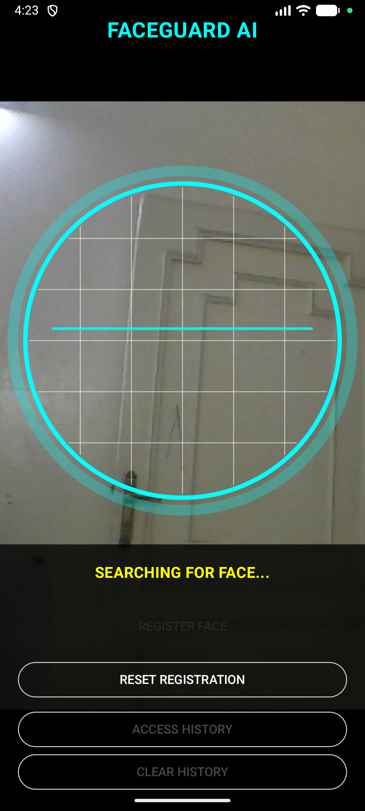
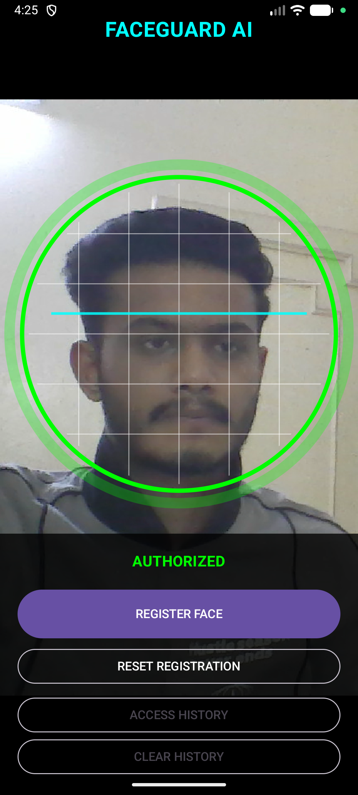
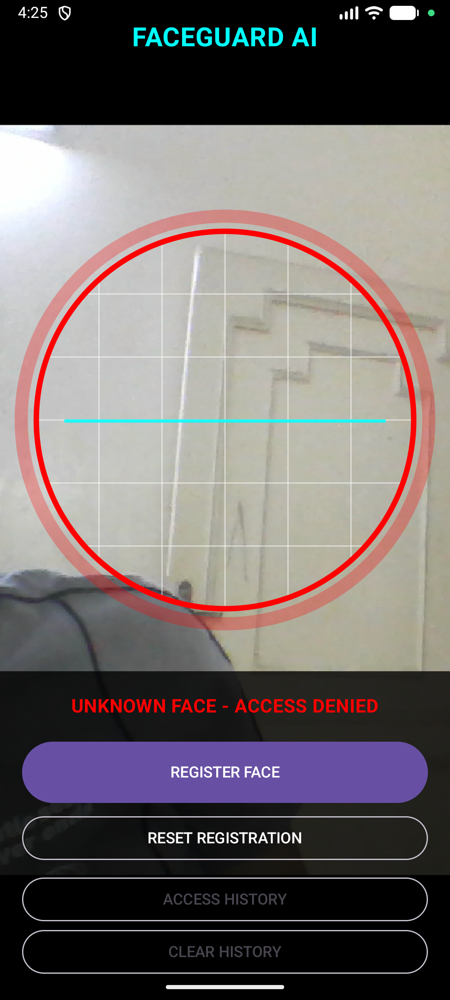
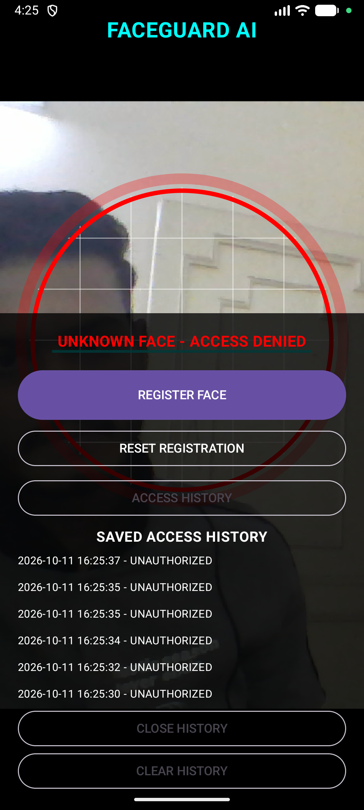

FACEGUARD AI 🔐

AI-Powered Face Recognition and Access Control Android Application

FACEGUARD AI is an educational Android project developed to demonstrate face detection, facial recognition, blink verification, and access history using Android technologies and machine learning.

🚀 Features

* 📷 Real-time face detection using the camera
* 🧠 Face recognition using facial embeddings
* 👁️ Blink detection for basic verification
* 🔒 Password-protected face registration
* ✅ Authorized face recognition
* ❌ Unknown face detection and access denial
* 📋 Access history with timestamps
* 💾 Persistent face registration
* 🎨 Animated scanning interface
* 🛡️ Custom FACEGUARD AI launcher icon

🛠️ Technologies Used

* Kotlin
* Android Studio
* Jetpack Compose
* CameraX
* Google ML Kit Face Detection
* MobileFaceNet face recognition model
* Git and GitHub

📱 Application Screenshots

1. Main Scanning Screen

2. Registration Password Dialog

3. Authorized Face

4. Unknown Face — Access Denied

5. Access History

⚙️ How It Works

1. The application accesses the camera after permission is granted.
2. ML Kit detects faces in camera frames.
3. MobileFaceNet generates a numerical representation (embedding) of the detected face.
4. The generated embedding is compared with the registered face.
5. Blink detection provides an additional verification step.
6. The application displays the recognition result and records access events.

▶️ How to Run

1. Install Android Studio.
2. Clone or download this repository.
3. Open the project in Android Studio.
4. Wait for Gradle synchronization to finish.
5. Run the app on an Android emulator or compatible device.
6. Grant camera permission when prompted.
7. Register a face and test recognition.

🧪 Testing

The following behaviors have been tested during development:

* Registered face displays AUTHORIZED.
* Unknown face displays ACCESS DENIED.
* Access history displays saved events.
* Face registration persists after restarting the app.

⚠️ Limitations

This project is an educational prototype and is not intended for production security use. Blink detection alone does not guarantee reliable liveness detection. A production version would require stronger anti-spoofing, secure credential storage, privacy protections, and additional testing.

👨‍💻 Author

Muhammed Miraz P

BCA — Robotics, Machine Learning and Artificial Intelligence

📌 Project Status

Core face detection, recognition, registration, and access-history features are implemented and tested. Further improvements are possible.s

📱 Application Screenshots

1. Main Scanning Screen
  

2. Face Registration
  

3. Face Recognition
   

4. Access Verification
  

6. Access History
   
